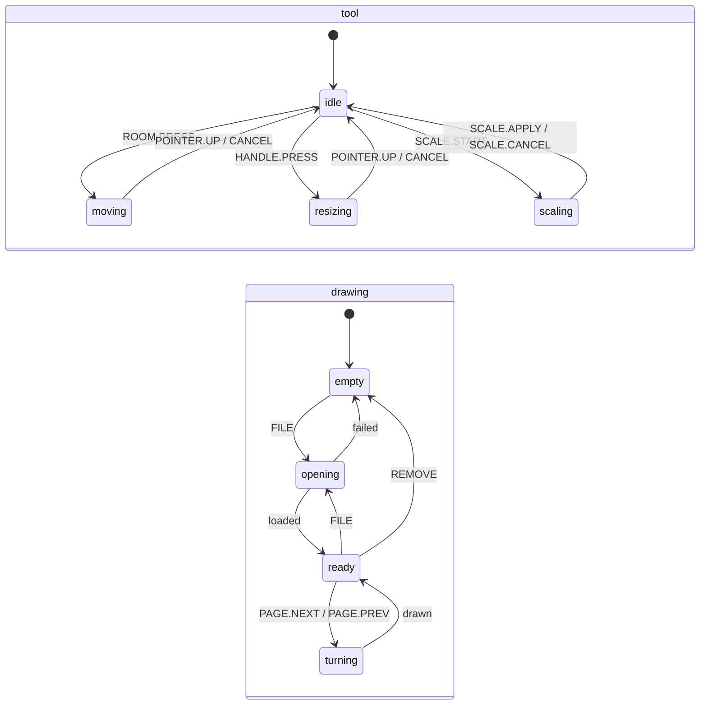

# Roomlines 3D planner

A floor plan editor that runs in one HTML page. You draw rooms as rectangles on a 2D plan and the page builds a furnished 3D model from them.

`index.html` is the page you host. `app.html` is the same page without the outer HTML document, which is the form Claude artifacts take. Edit `app.html`, then rebuild `index.html`:

```bash
./plan3d/build.sh
```

## What it does

- Rooms snap to a 0.25 m grid. Drag a room to move it and drag a corner to resize it.
- Walls come from the room edges. Two rooms that share an edge get an interior wall between them.
- Doors are placed so that every room can be reached from the entry room, going through the hallway first, then the living room. Living, kitchen and dining rooms that touch get a wide opening instead of a door.
- Each room gets windows on its outside walls, and the entry room gets a front door.
- Furniture is placed by room use: a bed and wardrobe in a bedroom, a counter run and table in a kitchen, and so on. Pieces keep clear of doors, and tall pieces keep clear of windows.
- The 3D view orbits with a drag, zooms with the wheel or a pinch, and pans with a right-drag or two fingers. Clicking a floor selects that room.

## Starting from a file

"Start from a file" takes an upload, a dropped file or a pasted image.

| File | What happens |
|---|---|
| PNG, JPG, WebP, GIF, SVG | The image is placed under the plan so you can draw rooms over it. |
| PDF | Each page is turned into an image and used the same way. Step through the pages to pick the right one. |
| `.json` | Loaded as a saved plan, in the format under "Plan format". |
| `.txt` | The text goes into the "Describe a home" box. |
| DWG, DXF and other CAD files | Not read. Export the drawing to PDF first. |

The drawing starts at a guessed size. "Set scale" fixes that: click the two ends of a length you know, type the real distance in metres, and the drawing is resized around the first point. "Clear rooms" leaves one room to start tracing with. The slider fades the drawing, and "Zoom to the home" switches the plan between the whole drawing and the rooms.

Opened as a Claude artifact, the card also has "Read it with Claude". Claude looks at the drawing and answers in one of two ways:

- For a floor plan, it returns each room as a rectangle. The page lines up edges that are nearly on the same line so that neighbouring rooms share a wall, then builds the plan over the drawing.
- For land, it returns the boundary of the plot and a home designed to fit inside it. The plot is drawn as a dashed outline on the plan and as grass in the 3D view.

Claude estimates the scale from printed dimensions or from door and furniture sizes, so treat the result as a first draft and check it against the drawing underneath. A plot can also be set by hand with a `plot` list of `[x, y]` corners in the plan JSON.

## Putting it on a website

Copy `index.html` to any static host. It loads XState 5.33.3 from jsDelivr (unpkg if that fails), three.js r128 from cdnjs and three fonts from Google Fonts. The first time someone uploads a PDF it also loads pdf.js 3.11.174 from cdnjs. Uploaded files are read in the browser and are not sent anywhere, except to Claude when "Read it with Claude" is pressed.

To put it inside an existing app, load `index.html` in an iframe, or copy the contents of `app.html` into a page of the app. The current plan is saved in the browser's local storage under `roomlines.plan`.

## Plan format

The "Plan data" box reads and writes this JSON. All numbers are metres, `x` runs left to right and `y` runs top to bottom.

```json
{
  "name": "Two bedroom",
  "rooms": [
    { "name": "Living room", "type": "living", "x": 0, "y": 0, "w": 5.5, "h": 4.5 },
    { "name": "Kitchen", "type": "kitchen", "x": 0, "y": 4.5, "w": 5.5, "h": 3.25 }
  ]
}
```

`type` is one of `living`, `kitchen`, `dining`, `bedroom`, `bathroom`, `office`, `hallway`, `laundry`, `storage` or `studio`. When it is missing, the page guesses from the room name.

The box also accepts a nested layout, which cannot produce gaps or overlaps:

```json
{
  "name": "Small flat", "width": 8, "depth": 6.5,
  "layout": { "dir": "row", "children": [
    { "size": 4.75, "name": "Living room", "type": "living" },
    { "size": 3.25, "dir": "col", "children": [
      { "size": 4, "name": "Bedroom", "type": "bedroom" },
      { "size": 2.5, "name": "Bathroom", "type": "bathroom" }
    ] }
  ] }
}
```

`row` places children left to right and `col` top to bottom. `size` is the length a child takes along that direction.

## Drawing from a description

Opened as a Claude artifact, the page shows a "Describe a home" box. It sends the description to Claude, which answers with a nested layout, and the page draws it. This box and "Read it with Claude" are hidden everywhere else, because a page on another host has no Claude to call. Uploading, the scale tool and tracing by hand work on any host. To get a drawn layout there, ask Claude in a chat for a plan in the nested layout format and paste the answer into "Plan data".

## State machines

Four flows in the page have more than two steps. Each one is an [XState](https://github.com/statelyai/xstate) v5 machine, defined in the "state machines" section of `app.html`. A machine only records which step its flow is in. The plan itself stays in `state.plan`.

| Machine | States | What it controls |
|---|---|---|
| `tool` | `idle`, `moving`, `resizing`, `scaling.first`, `scaling.second`, `scaling.distance` | What the pointer does on the 2D plan: dragging a room, dragging a corner, or the two clicks and the distance of "Set scale". Escape cancels any of them. |
| `drawing` | `empty`, `opening`, `ready`, `turning` | The uploaded image or PDF. A newer file or page turn replaces one that is still loading, so results cannot arrive out of order. |
| `describe` | `unavailable`, `idle`, `working.thinking`, `working.writing`, `blocked` | The "Draw it with Claude" request. |
| `read` | the same states as `describe` | The "Read it with Claude" request. It stops if the drawing changes while Claude is reading it. |



The current state of each machine is written on the page's outer `.wrap` element as `data-tool`, `data-drawing`, `data-describe` and `data-read`. CSS and tests can select on those, for example `.wrap[data-tool^="scaling"]`.

Simple on/off settings (furniture, cut walls, view mode, the selected room) are plain values in `state`. They have no steps to get wrong, so a machine would add code and remove nothing.

When a new flow has steps that must happen in order, or work that can be interrupted, add it as a machine. Do not add a flag.

## Scripting the page

`window.roomlines` drives the page without clicking. The buttons use the same functions, so a script cannot reach a state the page cannot.

```js
roomlines.getState()   // { machines: { tool: 'idle', drawing: 'empty', ... }, view, selection, drawing }
roomlines.getPlan()    // { name, units, rooms: [{ id, name, type, x, y, w, h }], plot }
roomlines.loadPlan({ rooms: [{ name: 'Lounge', x: 0, y: 0, w: 5, h: 4 }] })

const id = roomlines.addRoom({ name: 'Office', type: 'office', x: 5, y: 0, w: 3, h: 3 })
roomlines.updateRoom(id, { w: 4 })       // values snap to the 0.25 m grid
roomlines.removeRoom(id)
roomlines.select(id)
roomlines.setView({ mode: '3d', furniture: false, cut: true })

roomlines.can('tool', 'SCALE.START')     // false until a drawing is loaded
roomlines.send('drawing', 'PAGE.NEXT')   // returns the machine's new state
roomlines.openFile(file)                 // a File, as if it had been uploaded
const stop = roomlines.subscribe(s => console.log(s.machines))
roomlines.log                            // the last 100 transitions
roomlines.debug = true                   // print each transition to the console
```

## Tests

`tests/run.js` opens `index.html` in headless Chromium and checks editing, uploads, the scale tool, both Claude flows against a stand-in, the scripting API, the phone layout and a failed script download. It needs Playwright with Chromium available to Node.

```bash
cd plan3d/tests && npm install && npm test
```

Run `./plan3d/build.sh` first if `app.html` changed, because the tests load `index.html`.

## Limits

Rooms are rectangles, there is one storey, and doors, windows and furniture are placed automatically and cannot be moved by hand.
